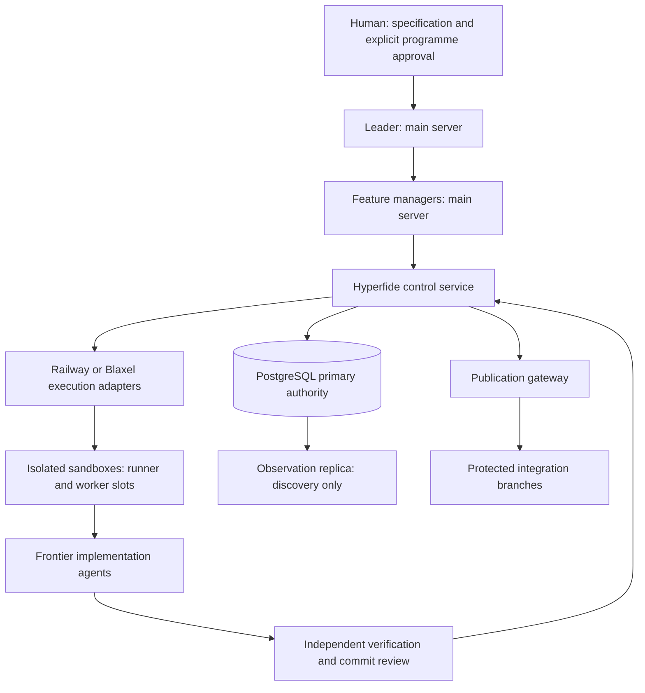

# Hyperfide operations

This guide describes implemented source interfaces and their evidence boundaries. It does not announce a production release. The implementation programme is Hyperfide 2.0; historical Codify feature IDs, Git commits and native provider names retain their original identities.

## Authority and topology



The main server hosts leadership, feature management and supervision. Builds, implementation and checker execution belong in sandboxes. A sandbox is not an agent: fixed resource capacity must be reserved before admitting worker slots, tests or builds. Hundreds of agents and 100 sandboxes are planning requirements, not measured throughput or availability guarantees.

The human interacts with the leader. Feature managers own their assigned packages and request work through Hyperfide; workers cannot acquire publication authority by naming a branch, posting a successful exit code or editing a task status. Claude Code and Codex remain frontier execution connectors. Auxiliary decision models may narrow, rank or flag; qualified evidence and deterministic gates decide acceptance.

## Source and qualification states

A source branch, successful compiler run, authoring check or task-component receipt does not qualify a full acceptance case. The canonical runner records the selected variant, exact input hashes, source inventory, process outcome, assertion inventory and cleanup. The independent checker revalidates those records.

The canonical case registry (tests/hyperfide/registry.json) currently holds 57 acceptance cases, V-001 to V-057, and every one has an empty full-case assertion inventory. Those cases are unregistered for full qualification and block release readiness. Do not fill missing evidence with component results, vendor benchmarks or unexecuted plan text. Provider, connector, restore, sustained-fleet and live-model measurements remain pending until their own exact-current receipts exist.

Support state at the documented source revision. Task status comes from spec/hyperfide/spec.kvx; component evidence comes from artifacts/hyperfide/tasks/<id>/evidence-index.json, a local cache of the S3 artifact store (see Evidence in the artifact store). Labels:

- **done**: the specification marks the task done.
- **implemented (component evidence)**: the source exists and the task's registered task-component variant passed. The task is still pending in the specification, and its full cases remain UNRUN.
- **pending**: the task is not closed and this tree has no passing task-component evidence for it.
- **proposed**: planning text only.

| Area | State | Owning task(s) |
| --- | --- | --- |
| Approval policy and dependency-enabled build boundaries | done | 1.4 |
| Main-host placement, human programme interface, frontier assignment policy | implemented (component evidence) | 1.1–1.3 |
| Control/provisioner/dispatch service entrypoints, policy-gated startup | done (policy, schema and gateway); implemented (component evidence) for the authenticated service | 1.4, 4.1, 4.2, 14.1 |
| Pinned run specification import | pending: source in services/hyperfide/src/spec, no task-component evidence index in this tree | 2.1 |
| Dependency graphs, versioned decomposition, proof obligations | implemented (component evidence) | 2.2–2.4 |
| Agent hierarchy, scoped packets and views | implemented (component evidence) | 3.1–3.4 |
| PostgreSQL authority schema, primary transaction gateway, migrations and old-primary fencing | done | 4.1, 4.2, 4.4 |
| Replica-barrier packet assembly | implemented (component evidence) | 4.3 |
| Claims, reservations, leases, dispatch reconciliation, resource admission | implemented (component evidence) | 5.1–5.4 |
| Outbox, inbox, instructions, dispatch recovery | implemented (component evidence) | 6.1–6.4 |
| Central graph extraction, staging, publication, query parity | implemented (component evidence) | 7.1–7.4 |
| Provider interface and UNSUPPORTED outcomes | done | 8.1 |
| Provider pools, intents/orphans, placement/relocation | implemented (component evidence) | 8.2–8.4 |
| Railway adapter | implemented (component evidence) | 9.1–9.4 |
| Blaxel coding images | done | 10.1 |
| Blaxel lifetime, create-or-get, preview gating | implemented (component evidence) | 10.2–10.4 |
| Content-derived environment profiles | done | 11.1 |
| Source and cache materialisation, readiness probes, prewarming | implemented (component evidence) | 11.2–11.4 |
| Packet-scoped workspace slices for very large repositories | pending: no source or evidence in this tree | 11.5 |
| Sandbox supervisor and worker slots | implemented (component evidence) | 12.1–12.4 |
| Claude Code and Codex connectors, session lineage | implemented (component evidence) | 13.1–13.4 |
| Identity enrolment, scoped credentials, authenticated HTTPS service | implemented (component evidence) | 14.1–14.4 |
| Attempt source, artifacts, checkpoints, retention | implemented (component evidence) | 15.1–15.4 |
| Independent task qualification | implemented (component evidence) | 16.1–16.4 |
| Commit and semantic assurance | implemented (component evidence) | 17.1–17.4 |
| Findings, GitHub projection, routing | implemented (component evidence) | 18.1–18.3 |
| Finding closure after fenced repair | implemented; component evidence fails (exit 1: 28 of 31 registered assertions pass, and the genuine-execution-start, independent-resolution and reopen assertions are unmet) | 18.4 |
| Integration candidates, publication gateway, closure, release barrier | implemented (component evidence) | 19.1–19.4 |
| Typed decision providers, bounded decision assistance, decision evaluation and promotion | implemented (component evidence) | 20.1–22.4 |
| Observability, resource accounting, notifications | implemented (component evidence) | 23.1–23.4 |
| Supervisory and sandbox recovery, stop/drain/cancel controllers, recovery drills | implemented (component evidence) | 24.1–24.4 |
| SQLite import, cutover/rollback, authority-mode routing, release planning | implemented (component evidence) | 25.1–25.4 |
| Hyperfide identity, canonical hyperfide entrypoint, cg compatibility, name/alias migration, generated guidance | implemented (component evidence) | 26.1–26.4 |
| Strict qualifier and independent receipt checker | done | 27.1 |
| Deterministic schedule replay | implemented (component evidence); full replay cases UNRUN | 27.2 |
| Live Railway/Blaxel provider and native agent qualification, 48/72-hour fleet campaigns | pending: campaign driver source (tests/hyperfide/campaigns/live.py) but no task-component evidence index; no measured limits exist | 27.3 |
| Composite fault qualification | implemented (component evidence, driver component only); full campaign blocked by O-06, O-09, destructive-execution approval, database failover topology and task 27.3 full receipts | 27.4 |
| Operational documentation, documentation closure, release readiness, traceability retention | implemented (component evidence) | 28.1–28.4 |
| Hundreds of agents / 100 concurrent sandboxes | proposed planning target | 27.3 |
| Optional Span GPU self-hosting | proposed; only the self-hosted promotion gate is implemented (component evidence) | 22.4 |

## Build and start

Run preparation and builds in an allocated execution sandbox, never on the leadership server:

```sh
npm --prefix services/hyperfide ci --ignore-scripts
npm --prefix services/hyperfide run build
```

The lockfile pins dependencies and the package declares Node 24.22.0. Start the appropriate entrypoint with an explicitly approved policy file, its exact specification revision, registered fragments and built module root:

```sh
node services/hyperfide/dist/control.js --policy /run/hyperfide/policy.json --spec-revision APPROVED_REVISION --components services/hyperfide/components --module-root services/hyperfide/dist
```

The corresponding source entrypoints are provisioner.js and dispatch.js. A missing approval, denied role/action, mismatched revision, absent linked module or invalid dependency graph refuses startup. The stdio protocol is bounded JSONL; its presence does not grant remote authority.

The authenticated network service uses the explicit HTTPS mode, trusted TLS certificate/key and identity configuration. Identity enrolment, request signatures, origin, nonce, credential version, deployment epoch and current run/boot/lease are enforced by the actual task 14.1 protocol. Never copy fixture credentials into an operational environment.

Every entrypoint (control.js, provisioner.js, dispatch.js) accepts exactly these flags, parsed by services/hyperfide/src/components/service.ts; any other flag refuses startup with INVALID_ARGS:

| Flag | Meaning |
| --- | --- |
| --policy FILE | Required. Trusted approved policy JSON, regular file of at most 1 MiB. |
| --spec-revision REV | Required. Must equal the revision approved in the policy. |
| --components DIR | Component fragment directory (default services/hyperfide/components). |
| --module-root DIR | Built module root (default services/hyperfide/dist). |
| --mode stdio\|https\|daemon | Default stdio (bounded JSONL on stdin/stdout). https and daemon print a ready event on stderr and run until SIGTERM/SIGINT. The provisioner refuses daemon with TRANSPORT_CONFIG. |
| --host, --port | HTTPS listener address (host default 127.0.0.1). |
| --tls-cert, --tls-key | HTTPS certificate and private key. |

HTTPS mode refuses with AUTH_REQUIRED unless the 14.1 identity component is registered, and refuses with TRANSPORT_CONFIG when HYPERFIDE_MIGRATION_JOB=1. HF_SERVICE_MAX_REQUEST_BYTES and HF_SERVICE_MAX_RESPONSE_BYTES set protocol byte limits (default 1 MiB, range 256 bytes to 64 MiB; HTTPS is further capped at 1 MiB). These are configured bounds, not measured capacity.

The provisioner unit (deploy/hyperfide/provisioner.service) runs the same authenticated HTTPS transport as the control and dispatch units. Its listener comes from HYPERFIDE_PROVISIONER_LISTEN_HOST and HYPERFIDE_PROVISIONER_LISTEN_PORT in /etc/hyperfide/provisioner.env (template deploy/hyperfide/env/provisioner.env.example), with /etc/hyperfide/provisioner.crt and /etc/hyperfide/provisioner.key. Its identity configuration, HF_IDENTITY_CONFIG_FILE=/etc/hyperfide/provisioner-identity.json (template deploy/hyperfide/identity/provisioner-identity.example.json), must carry the canonical https origin that callers sign for, naming the certificate's host and the listener port; the placeholder origin refuses startup with COMPONENT_LOAD_FAILED (Invalid HTTPS origin) until it is replaced. Every provisioner-gated action, including provider.pools.configure, provider.pools.attest-capacity, provider.pools.observe, provider.intents.execute and provider.intents.reconcile, is reachable only through this listener and only for principals whose granted actions include it.

The provisioner worker starts at service boot without a provider.worker.start call. The service signs a provider.worker.start invocation for itself with the key named in HF_PROVISIONER_EXECUTOR_CONFIG_FILE=/etc/hyperfide/provisioner-worker.json (template deploy/hyperfide/identity/provisioner-worker.example.json: schema_version 1, exactly one principal with credential_id and key_path, concurrency) and authenticates it through the 14.1 identity authority, as the runner executor does. The configuration file and the key it names must be absolute, owned by the service user, mode 0600, single-link regular files and not symlinks; anything else, a principal that is not the current ACTIVE PROVISIONER for the run's authority epoch, or a key that does not match it refuses startup with PROVISIONER_EXECUTOR_CONFIG_INVALID or PROVISIONER_EXECUTOR_IDENTITY_MISMATCH before the listener opens. Migration 0707-provisioner-worker-starts must be applied first (PROVISIONER_WORKER_SCHEMA_REQUIRED otherwise).

Worker starts are durable per run in hyperfide.provisioner_worker_starts. A restart resumes the recorded start (resume_count increases, start_count and started_at do not); repeated provider.worker.start calls against a running worker change nothing. provider.worker.stop records STOPPED, so the next boot is a new start. A STARTED record owned by another current PROVISIONER credential refuses startup with WORKER_ALREADY_RUNNING; revoke or expire that credential before rotating the worker key. provider.worker.status reports the durable record beside the live loop state.

Observed refusals from the built entrypoint in a task sandbox (exit code 1):

```text
$ node services/hyperfide/dist/control.js
{"ok":false,"error":{"code":"INVALID_ARGS","message":"Explicit trusted policy and pinned specification revision required"}}
$ node services/hyperfide/dist/control.js --policy /nonexistent --spec-revision X
{"ok":false,"error":{"code":"POLICY_INVALID","message":"Trusted policy file is unavailable"}}
```

Authenticated startup, refusal of a request that claims its own approval, refusal of a request for another run and service restart are exercised against PostgreSQL by tests/hyperfide/cases/tasks/28_1.py; the recorded outcome is artifacts/hyperfide/tasks/28.1/evidence-index.json (local, force-added evidence; not a full-case receipt).

An installed release launches its own runtimes directly: runtime/node, bin/hyperfide, bin/hyperfide-native and runtime/python/bin/python3 (a wrapper over python3.bin) run under the host dynamic loader /lib64/ld-linux-x86-64.so.2 with the host glibc, and take every other native library from the release (bin/hyperfide and bin/hyperfide-native through RUNPATH $ORIGIN/../lib/hyperfide, the service units and the migration job through LD_LIBRARY_PATH=<release>/lib/hyperfide, Python through runtime/python/lib). glibc itself is never bundled, so a host needs a glibc no older than the one on the release build host; scripts/release.sh refuses to construct a release that stages a glibc member or whose node does not run both plainly and under the bundled library path.

## Host bootstrap

deploy/hyperfide/bootstrap-host.mjs prepares a host for the three service units. Run it as root from the installed release; it is idempotent, so rerun it after every release to pick up new templates:

    /opt/hyperfide/current/runtime/node /opt/hyperfide/current/deploy/hyperfide/bootstrap-host.mjs

It creates the hyperfide group (gid 1900) and the system users hyperfide (uid 1900, control), hyperfide-provisioner (1901) and hyperfide-dispatch (1902), all with primary group hyperfide, home /nonexistent and shell /usr/sbin/nologin, through groupadd and useradd. An existing account with another id, group, home or shell refuses with BOOTSTRAP_IDENTITY_CONFLICT before any tree is created. It then creates /etc/hyperfide and /var/lib/hyperfide (root:hyperfide 0750), one state directory per role with its authority-journal (and, for the provisioner, preparation) directory (role user, 0700), and installs:

| Installed file | Source | Owner and mode |
| --- | --- | --- |
| /etc/hyperfide/ROLE.env | deploy/hyperfide/env/ROLE.env.example | root:root 0600 |
| /etc/hyperfide/ROLE-policy.json | deploy/hyperfide/policies/ROLE.example.json (task 29.5) | role user 0600 |
| /etc/hyperfide/ROLE-identity.json, provisioner-worker.json | deploy/hyperfide/identity/*.example.json | role user 0600 |
| /etc/systemd/system/hyperfide-ROLE.service | deploy/hyperfide/ROLE.service | root:root 0644 |
| hyperfide-ROLE.service.d/db-env.conf | EnvironmentFile=/etc/hyperfide/ROLE.db.env | root:root 0644 |
| hyperfide-ROLE.service.d/preflight.conf | ExecStartPre running bootstrap-host.mjs --preflight ROLE | root:root 0644 |
| /etc/hyperfide/grants.sql | deploy/hyperfide/grants.sql | root:root 0644 |

Every file is created atomically and only when absent. An existing file is never rewritten or read, unless it is a release-owned unit, drop-in or grants.sql, which is compared and listed under differs when the release changed it; review and replace those by hand. An existing file that is a symlink, has more than one link or the wrong owner or mode refuses with BOOTSTRAP_CONFIG_UNSAFE. The script never creates a database URL, certificate, key or provider configuration; the outcome line lists each one still absent under operator_pending. HYPERFIDE_BOOTSTRAP_ROOT or --root DIR points the same steps at a prefix tree (useradd and groupadd run with --root), which is how acceptance case V-066 exercises it; only the real root runs systemctl daemon-reload.

The preflight runs as each unit's ExecStartPre, as the unit's user and with its environment, before the entrypoint starts, and exits 78 with the refusal code the service itself would raise:

| Gap | Refusal |
| --- | --- |
| Any HYPERFIDE_MIGRATION_* variable present | MIGRATION_CREDENTIAL_EXPOSED |
| HYPERFIDE_REQUIRE_SYNC_REPLICA not 0 or 1 | DURABILITY_POLICY_REQUIRED |
| HYPERFIDE_DEPLOYMENT_ID not a UUID, or HYPERFIDE_AUTHORITY_JOURNAL_DIR missing, not canonical, not owned by the unit's uid or group/world accessible | EXTERNAL_JOURNAL_REQUIRED |
| Control without a 64-hex-character HYPERFIDE_CAUSAL_BARRIER_KEY | BARRIER_CONFIG_INVALID |
| Listener host or port, or HYPERFIDE_SPEC_REVISION, missing | TRANSPORT_CONFIG |
| HYPERFIDE_ROLE_PRIMARY_DATABASE_URL missing or not postgres | DATABASE_CONFIG_INVALID |
| HF_IDENTITY_CONFIG_FILE missing | IDENTITY_CONFIG_REQUIRED |
| Dispatch without HF_EVENT_DISPATCH_CONFIG | DISPATCH_CONFIG_REQUIRED |
| Provisioner without an absolute HF_PROVISIONER_EXECUTOR_CONFIG_FILE | PROVISIONER_EXECUTOR_CONFIG_INVALID |
| HYPERFIDE_EXTERNAL_FENCE_CONFIG_FILE missing or not canonical | EXTERNAL_FENCE_CONFIG_REQUIRED |
| Fence configuration not a single-link 0600 file owned by the unit's uid | EXTERNAL_FENCE_CONFIG_UNSAFE |
| Fence configuration fields, scope or topology invalid | EXTERNAL_FENCE_CONFIG_INVALID |
| A required writer without an isolation boundary | EXTERNAL_FENCE_CONFIG_INCOMPLETE |
| HYPERFIDE_POOL_CONFIG missing | POOL_CONFIG_REQUIRED |
| HF_RAILWAY_CONFIG missing | Railway trusted configuration missing |

The preflight prints only the outcome and code, never a value. A passing preflight does not prove that migrations, grants or an authority epoch exist; the service checks those at startup.

A new host follows this sequence:

1. Install the release with install-service.mjs (--service-uid 1900 --service-gid 1900), then run the bootstrap above.
2. Edit /etc/hyperfide/ROLE.env for each role. Write /etc/hyperfide/ROLE.db.env by hand (root:root 0600) with the role's HYPERFIDE_ROLE_PRIMARY_DATABASE_URL, the scoped runtime login only; never pass a database URL through a script or put a migration credential in either file. Place each role's ROLE.crt and ROLE.key, the provisioner's external-fence.json, pools.json, railway.json and worker key, and the dispatch worker configuration with its key, with the owner and mode the table above names. Replace the policy and identity placeholders.
3. Apply migrations with the migration credential in the operator's own environment (migrate.mjs --apply, see PostgreSQL and migrations).
4. Apply grants.sql once per runtime login as the database owner. Grants need the migrated tables, so this follows step 3; rerun it after every migration.
5. Activate the first epoch for control and adopt it for the provisioner and dispatch, as described in First authority epoch.
6. Start the units: systemctl enable --now hyperfide-control hyperfide-provisioner hyperfide-dispatch. A unit whose preflight refuses does not start; journalctl -u hyperfide-ROLE shows the code.

Identity enrolment of the service principals stays with bootstrap_identity.ts (task 26.4).

## Local CLI

The local-first CLI is the hyperfide executable. cg is a deprecated compatibility alias from the same executable, with identical arguments, JSON and exit codes; it is byte-identical at this revision, and version prints 2.0.0-dev for both. It stays for the compatibility window of the approved release (see hyperfide help, "command names"). The CLI is not a control-service client and grants no distributed authority. Commands relevant to operations, all listed by hyperfide help --all:

| Command | Use |
| --- | --- |
| hyperfide version | Print the version. |
| hyperfide config [init\|get\|set\|check] | Read or validate hyperfide.kvx settings (a legacy codify.kvx is read when it is the only file) with their origin. |
| hyperfide docs status\|plan\|packet\|check\|trace\|close | Local grounded documentation closure evidence. |
| hyperfide spec docs status\|auto\|manual\|off\|start\|block\|reset\|done | The reserved @docs closure stage. |
| hyperfide fleet up\|down [--drain] [--wait SECONDS]\|pause\|resume\|runs\|status | Local run supervision; fleet down releases claims and keeps branches. |
| hyperfide journal list\|apply\|drop | Writes queued while the local database was busy. |

The configuration file is hyperfide.kvx (src/config.c); a tree that has only the legacy codify.kvx keeps reading it, and a tree with both is refused unless .hyperfide/names.json records a completed names migration. The 26.3 component migrates codify.kvx to hyperfide.kvx with a backup (docs/config.md). The installer (scripts/install.sh) is not advertised as a Hyperfide release until tasks 25.4 and 26.2 close.

## PostgreSQL and migrations

Connection settings are read by services/hyperfide/src/storage/runtime.ts. Each role uses HYPERFIDE_<ROLE>_PRIMARY_DATABASE_URL (for example HYPERFIDE_CONTROL_PRIMARY_DATABASE_URL), falling back to the DATABASE_URL compatibility setting; HYPERFIDE_<ROLE>_REPLICA_DATABASE_URL is optional; migrations require HYPERFIDE_MIGRATION_DATABASE_URL and run with one connection. Bounded settings: HYPERFIDE_PG_LISTENER_MAX (default 1, maximum 4), HYPERFIDE_PG_MAX_QUEUED (default 32, maximum 1024), HYPERFIDE_PG_SYNCHRONOUS_COMMIT (on or remote_apply) and HYPERFIDE_REQUIRE_SYNC_REPLICA (0 or 1). A process that already owns a different PostgreSQL configuration refuses with DATABASE_CONFIG_CONFLICT. Replicas serve observation and discovery; ownership changes, leases, qualification and publication must revalidate on the primary. A replica is not a second writable authority.

Migration credentials are dedicated to the migration operator. Task 4.4 owns ascending, checksummed migrations; request handlers never create their own tables. Missing schema is a readiness refusal. Preserve already applied SQL bytes and their checksums. The 28.2 documentation migration adds immutable packet, checker, baseline and closure records with the authority transaction-isolation guard.

Run policies and runtime grants ship with the deployment files. deploy/hyperfide/policies/control.example.json, provisioner.example.json and dispatch.example.json each list every action the role's registered components admit, its startup action and, for dispatch, the standing worker actions plus every control action as a route candidate. Replace the programme, repository, approval record and specification revision placeholders, keep allowed_actions unchanged, and install each file as that role's --policy. A dispatch route whose action is missing from the dispatch policy refuses startup with DISPATCH_CONFIG_INVALID. After any change to component registrations, regenerate the examples with python3 tests/hyperfide/cases/tasks/29_5.py --write-policies; acceptance case V-062 fails and names each missing or unregistered action when a shipped list drifts.

After migrations, the database owner that ran them applies deploy/hyperfide/grants.sql once per runtime login, for example psql "$OPERATOR_DATABASE_URL" -v runtime_role=hyperfide_control -f deploy/hyperfide/grants.sql, then again for the provisioner and dispatch logins. The script refuses a runtime login that is privileged, owns objects or is a member of another role; grants CONNECT, schema USAGE, SELECT on every table and INSERT, UPDATE and DELETE on every table except schema_migrations; and fails if the login keeps any migration privilege. Rerun it after every migration, since it sets no default privileges. Topology observation needs EXECUTE on pg_catalog.pg_control_system() and pg_control_checkpoint(). PostgreSQL grants that to PUBLIC by default, so the script only checks it. If a cluster revoked it, the script stops with an error naming the function, and a superuser has to run the script to grant it. Never give a runtime role the operator or superuser credential.

Primary transactions use the shared 4.2 gateway. Identity guards run inside each actual transaction attempt and are repeated after retry. A lost COMMIT acknowledgement is an unknown outcome: reconcile the durable operation identity before another external side effect. Do not infer safe failover from an epoch row or a caller boolean; production promotion requires actual old-primary/control-writer fencing.

## First authority epoch

Every ordinary control, provisioner and dispatch service refuses to start until an ACTIVE epoch exists for HYPERFIDE_DEPLOYMENT_ID in the primary and the same epoch is current in that unit's own authority journal (HYPERFIDE_AUTHORITY_JOURNAL_DIR, a private directory owned by the unit's uid). A fresh install obtains its first epoch exactly once, after `--apply` has run, with the release fence driver `deploy/hyperfide/bootstrap-fence.mjs`. The driver never reads a signing key: the operator signs the isolation permit off-box.

1. Environment for the control uid. Every path is absolute and every file is owned by that uid with mode 0600 (directories 0700) unless noted:
   - DATABASE_URL and HYPERFIDE_MIGRATION_DATABASE_URL for the primary, HYPERFIDE_DEPLOYMENT_ID, and HYPERFIDE_AUTHORITY_JOURNAL_DIR (the control journal).
   - HYPERFIDE_WRITER_ISOLATION_CONFIG: the writer isolation configuration. It names this deployment, `source_epoch: null`, `evidence_scope: "LIVE_PROVIDER"`, and every provider resource that can write (scope, native sandbox and boot generation, boot id, preparation digest).
   - HF_LEGACY_WRITER_CONFIG_FILE: the legacy writer topology. Its `legacy_writer_id` is one of the isolation resource keys, its data roots are read-only mounts, and its pid and mount namespaces are those the activation job runs in.
   - HYPERFIDE_POOL_CONFIG: the active pool configuration.
   - HF_RAILWAY_CONFIG: live mode, not group or world writable. Also set the token variable it names in `token_env`. Set the Blaxel administrative credentials when a resource is on Blaxel.
   - HYPERFIDE_EXTERNAL_FENCE_JOURNAL_DIR: a private, empty fence journal directory.
   - HYPERFIDE_ISOLATION_PERMIT_VERIFIER_FILE: `{"schema_version":1,"issuers":[{"key_id":KEY_ID,"public_key_b64":RAW_ED25519_PUBLIC_KEY_BASE64URL}]}`, not group or world writable.
   - HYPERFIDE_ISOLATION_PERMIT_FILE: the signed permit, written in step 5.
2. Topology digest. Run `node deploy/hyperfide/bootstrap-fence.mjs --topology`. It prints the derived topology and its `topology_digest`. Write that digest into the isolation configuration as `topology_digest` and as every resource's `resource_topology_digest`, then rerun it until it reports `"consistent":true`. Any later change to the resources, the legacy topology or the namespaces changes the digest.
3. Permit payload. Choose the activation operation id (UUID) and run `node deploy/hyperfide/bootstrap-fence.mjs --permit-payload --operation-id UUID --key-id KEY_ID [--ttl-seconds N] --output-dir DIR`. DIR is a private directory. The command writes `DIR/permit.payload` (the canonical claims: purpose EXTERNAL_WRITER_ISOLATION_ONLY, deployment, operation, organisation, run, null source epoch, topology digest, the exact resource allowlist, issue and expiry times, nonce) and `DIR/permit.signing-input`. The lifetime defaults to 900 seconds and is bounded to 60 to 3600 seconds.
4. Signing, off-box. Review the payload, then sign the signing input with the issuer's Ed25519 key, for example `openssl pkeyutl -sign -rawin -inkey KEY.pem -in permit.signing-input -out permit.sig`. Return the 64-byte `permit.sig`.
5. Sealing and verification. Run `node deploy/hyperfide/bootstrap-fence.mjs --seal-permit --operation-id UUID --key-id KEY_ID --payload DIR/permit.payload --signature permit.sig --output PERMIT`. It builds the canonical envelope, verifies it with the configured public keys against this deployment, operation and topology digest, and writes PERMIT with mode 0600. Point HYPERFIDE_ISOLATION_PERMIT_FILE at PERMIT. `--verify-permit --operation-id UUID` repeats the check. An unsigned or altered envelope (ISOLATION_PERMIT_INVALID), a permit for another deployment, operation or topology (ISOLATION_PERMIT_SCOPE) and an expired permit (ISOLATION_PERMIT_EXPIRED) are refused. So is an isolation configuration whose digests differ from the derived topology (EXTERNAL_FENCE_TOPOLOGY_DIGEST_MISMATCH). Each of these happens before any provider effect or epoch.
6. Activation, inside the configured legacy namespaces and before the permit expires:

       node deploy/hyperfide/migrate.mjs --activate-authority --release-root RELEASE --policy-file POLICY --spec-revision REV --operation-id UUID --fence-driver deploy/hyperfide/bootstrap-fence.mjs

   The policy must admit storage.authority.activate for the control role. A relative `--fence-driver` resolves inside the release root and must be a root-owned file with no group or world write. An absolute one must be a private operator module (owned, mode 0600). The driver verifies the permit again, disables legacy admission, and isolates every configured resource through the provider admin transport. Isolation runs only after a fresh retained-custody proof for the exact sandbox and boot. The job builds the fence itself, so it refuses:
   - a component-fixture topology (EXTERNAL_FENCE_EVIDENCE_SCOPE_MISMATCH);
   - an unverified permit (ISOLATION_PERMIT_REQUIRED);
   - an unknown provider outcome (EXTERNAL_FENCE_OUTCOME_UNKNOWN);
   - a receipt whose validity exceeds 30 seconds or that has expired at primary admission (EXTERNAL_FENCE_INVALID, EXTERNAL_FENCE_EXPIRED).

   Service code that reaches activation through storage.authority.v1 accepts only a fence built by createExternalWriterFence.

The activation is BOOTSTRAP only when the deployment has no authority history. Re-running the same operation id replays the committed epoch without minting. Any other bootstrap while an epoch exists, including a revoked one, is refused with AUTHORITY_BOOTSTRAP_EXISTS. A lost publication is AUTHORITY_ACTIVATION_UNKNOWN (exit 75): rerun the same operation id to reconcile, never a new one.

7. Follower adoption. The provisioner and dispatch units run as different uids and cannot share the control journal. Copy the committed document `<HYPERFIDE_AUTHORITY_JOURNAL_DIR>/<HYPERFIDE_DEPLOYMENT_ID>.authority.json` to a file owned by the follower's uid with mode 0600. Then run the following as that uid, with its own journal directory and a policy file it owns:

       node deploy/hyperfide/migrate.mjs --adopt-authority --release-root RELEASE --policy-file POLICY --spec-revision REV --operation-id UUID --journal-document FILE

   The policy must admit storage.authority.adopt. Adoption validates the document's hash chain, requires the ACTIVE state and a positive primary receipt whose proof digest matches the last record, and never mints an epoch. A PENDING, tampered, forked or rolled-back document is refused.
8. Service start. Start the control, provisioner and dispatch units. Each one checks that the epoch in its own journal is the primary's ACTIVE epoch. Every outcome line, and install-service.mjs's receipt, reports authority_activated read from the primary (null when the read itself failed). Remove the permit and the payload directory after activation; the permit is valid only for this operation id.

### Greenfield first epoch

A fresh deployment has no writer to isolate, and its runs, pools, sandboxes and boots can only be created behind an ACTIVE epoch. Its first epoch therefore uses a greenfield configuration: the operator proves that nothing exists, and the activation creates the accepted-intent rows in the same primary transaction as the epoch. The commands are the same as above and follow the scope of the isolation configuration. The driver never reads a signing key.

1. Environment for the control uid, as in step 1 above, with these differences:
   - HYPERFIDE_WRITER_ISOLATION_CONFIG names this deployment, the organisation and run of the accepted intent, `source_epoch: null`, `evidence_scope: "LIVE_PROVIDER"`, `"scope": "GREENFIELD"` and `"resources": []`. A greenfield configuration that names a resource is refused with ISOLATION_PERMIT_SCOPE.
   - HF_LEGACY_WRITER_CONFIG_FILE is unset. A configured legacy writer is refused with ISOLATION_PERMIT_SCOPE.
   - HYPERFIDE_GREENFIELD_INTENT_FILE: `{"schema_version":1,"scope":{"organisation_id","project_id","run_id","allowed_actions"},"metadata":...,"accepted_intent":...}`, with the metadata and accepted intent of the first `hyperfide bootstrap` input. HYPERFIDE_BOOTSTRAP_SOURCE_ROOT is the directory that holds the accepted spec source.
   - HYPERFIDE_POOL_CONFIG names the same organisation. Every pool in it is inventoried through its provider admin transport. Only Railway has one, so HF_RAILWAY_CONFIG must be in live mode with its token set.
2. Topology digest. `--topology` prints the greenfield topology: zero required writers, zero resources, legacy status NONE, the accepted-intent digest and every configured pool scope. Write its `topology_digest` into the isolation configuration and rerun it until it reports `"consistent":true`.
3. to 5. Permit. `--permit-payload` writes claims with `"scope":"GREENFIELD"` and an empty resource allowlist. Signing, sealing and `--verify-permit` work as above. A greenfield permit is refused against a writer configuration, and a writer permit against a greenfield one, with ISOLATION_PERMIT_SCOPE.
6. Activation. Use the same `migrate.mjs --activate-authority ... --fence-driver deploy/hyperfide/bootstrap-fence.mjs` command. Before any epoch is minted, the driver refuses a deployment with any authority history with ISOLATION_PERMIT_SCOPE. It then proves emptiness:
   - the primary holds no sandboxes, sandbox_boots, provider_pools or runs rows for the organisation;
   - a complete inventory of every configured pool shows no sandbox other than a DESTROYED one.

   Anything present is refused with GREENFIELD_NOT_EMPTY. An incomplete or failed inventory, or a pool whose provider has no inventory transport, is refused with GREENFIELD_EMPTINESS_UNPROVEN. The fence journal keeps the evidence document (scope GREENFIELD, resource_count 0, legacy_status NONE, the empty writer list, each inventory and the database counts) next to a receipt of at most 30 seconds. The primary transaction inserts the BOOTSTRAP epoch, rechecks emptiness, and imports the organisation, project, repositories, source objects, spec revision and run through the accepted-intent importer, with the run pinned to the new epoch. Re-running the same operation id replays the committed epoch. Service-reachable storage.authority.v1 refuses a greenfield fence.
7. Follower adoption and service start: steps 7 and 8 above.
8. First operator. Run `hyperfide bootstrap --input FILE` with the same scope, metadata and accepted intent, the new epoch as `authority_epoch` and the operator credential. The import replays, and the first OPERATOR is issued.

## Preparation, secrets and execution

A preparation receipt binds an exact repository commit/tree, prerequisites, manifest and execution profile. It must be complete before admitting a worker. Inject scoped environment and credential references through the approved provider/identity path. Do not log secret values, embed them in public manifests or share leader credentials with workers.

Provider acceptance, a sandbox ID and runner readiness are separate states. Reconcile provider state using the actual native account/environment/resource identity, then enrol the exact sandbox boot. The advertised Railway/Blaxel account capacity is an input to planning; live provider limits, image publication and process execution need their own qualification.

Provider capability differences implemented by the adapters (services/hyperfide/src/providers). An UNSUPPORTED outcome is explicit; there is no emulated support:

| Capability | Railway (providers/railway) | Blaxel (providers/blaxel) |
| --- | --- | --- |
| Stop signal | TERM and KILL | TERM only; KILL is UNSUPPORTED. A stopped API parent leaves the outcome UNKNOWN until job-tree cleanup is reconciled. |
| Persistent volumes | Refused (persistent_volume_bytes must be 0) | Refused until per-boot qualified volume allocation exists |
| Process stdin | Unavailable after detach or restart | — |
| Attach with resume cursor | — | UNSUPPORTED |
| Resources | Memory must be exactly representable | CPU and memory must match provider coupling; writable overlay cannot exceed memory; timeouts in whole seconds |
| Pre-boot worker credentials | — | Disabled; use post-enrolment process references |
| Snapshots, network policy, copy, lifetime methods | — | UNSUPPORTED in the process adapter (lifetime policy is a separate ttl-idle/ttl-max-age/date delete policy) |
| Account limits | Planning input only | account_limits_qualified must be declared; live limits pending 27.3 |

Provider components: 8.2 provider.pools.*, 8.3 provider.intents.* and provider.orphans.list, 8.4 provider.placement.* and provider.relocation.*. All three components register in the provisioner role, and 8.2 and 8.3 also register in the control role. Contract checks report authority NONE and live_qualification NOT_EVALUATED.

Remote work is prepared in a primary transaction, its intent is committed, then the opaque runner permit executes. No remote build occurs inside a PostgreSQL transaction. Unknown execution or cleanup remains unknown and retains capacity until reconciliation proves otherwise.

### Internal object store and regional mirrors

Sandboxes never clone or fetch from GitHub; GitHub receives only the publication projection. Source comes from an internal object store: a bare Git repository on your infrastructure, with a bare mirror in each provider region, reachable over that provider's private network (for Railway, a `*.railway.internal` host).

The provisioner environment file names the configuration with `HF_SLICE_SOURCE_CONFIG` (an absolute path, at most 256 KiB, for example `/etc/hyperfide/object-store.json`):

```json
{"schema_version": 2, "missing_region": "STORE",
 "repositories": {"<repository id>": {
   "store": "ssh://objects.example.internal/srv/hyperfide/monorepo.git",
   "mirrors": {"railway": {"us-west2": "ssh://objects-usw2.railway.internal/srv/monorepo.git"}},
   "submodules": {"vendor/lib": {"store": "ssh://objects.example.internal/srv/lib.git", "mirrors": {}}}}}}
```

- Mirrors are keyed by provider, then region. Materialisation (`preparation.slice.materialize`) reads the provider and region of the sandbox's pool and clones from that mirror. `missing_region` is required and has no default: `STORE` sends a region without a mirror to the store, `REFUSE` refuses it with `SLICE_SOURCE_NO_REGIONAL_MIRROR`.
- Every URL must be a credential-free `https`, `ssh` or absolute `file` URL. A `github.com`, `*.github.com` or `*.githubusercontent.com` host anywhere in the file is refused with `SLICE_SOURCE_GITHUB_REFUSED`. The schema 1 file (`url` per repository) is still read, as a store with no mirrors, under the same refusal.
- A mirror that has not yet received the pinned commit is stale. Materialisation discards that clone, clones from the store, and records `source.mirror_holds_commit: false` in the materialisation evidence.
- In live mode, `railwayMaterialisationSource` (railway.preparation.v1) refuses a Railway mirror that is not on the private network.
- Store and mirrors must allow partial clone and pinned fetches: `git config uploadpack.allowFilter true` and `git config uploadpack.allowAnySHA1InWant true`. Keep mirrors current with `git fetch --prune origin` from the store (they are `git clone --mirror` copies).
- Freshness: `node deploy/hyperfide/bootstrap-host.mjs --object-store-freshness <repository id>` compares every mirror's refs with the store's and prints each one as FRESH, STALE (refs `behind` or `extra`) or UNREACHABLE. It exits 0 only when every mirror is FRESH, 1 otherwise, and 78 with `SLICE_SOURCE_STORE_UNREACHABLE` when the store does not answer. Provisioner preflight validates the file when the variable is set.

## Verification and publication

A worker submission enters durable custody for its exact commit and source manifest. Independent verifier jobs, review coverage, blocking findings and integration candidate gates govern publication. Transport credentials stay behind the publication gateway; expected old/new object IDs and current authority are checked at the actual Git side effect.

The canonical component command shape is below. Use a fresh output directory for each changed immutable manifest.

```sh
python3 tests/hyperfide/qualify.py --case V-035 --manifest tests/hyperfide/manifests/tasks/28.2.json --output-dir /tmp/hyperfide/docs-component-campaign
python3 tests/hyperfide/check-evidence.py --campaign /tmp/hyperfide/docs-component-campaign
```

This selects the registered task-component inventory. It does not replace a full-case campaign. A completed receipt chain whose authentication is described as unanchored-consistency-only proves internal consistency; authoritative admission still requires trusted execution custody and the exact current gate.

### Evidence in the artifact store

The S3 artifact store (services/hyperfide/src/artifacts/objects.ts, backend s3-v1) is the authority for task evidence. artifacts/hyperfide/tasks/<id> is a local cache and is gitignored.

Publishing. Bundle the task directory with `python3 tests/hyperfide/qualify.py --bundle-evidence <id> --bundle-output <file>`. This writes a deterministic tar with sorted members and zeroed times and owners. A control-side caller passes the bytes to `publishEvidenceBundle`. It stores 256 KiB chunks with artifact.object.put and commits them with artifact.manifest.commit. It then reads the manifest back with artifact.manifest.read and returns a receipt record. Commit that record as tests/hyperfide/evidence-receipts/<id>.json. The record holds the manifest receipt (receipt_id binds organisation, run, artifact, digest, size, backend, key and completion time) and the bundle content digest. Every chunk and the manifest use retention class RELEASE (`EVIDENCE_RETENTION`: no deadline, no hold). artifact.retention.collect treats them by the active retention policy's minimum_age_ms.RELEASE. A null value means indefinite retention (INDEFINITE_RETENTION blocker), which evidence needs while a tracked receipt record names the manifest. Chunks also stay while their parent manifest is retained.

Resolving. When artifacts/hyperfide/tasks/<id> is absent, qualify.py (default output directory) and check-evidence.py (a --campaign path under that directory) read the receipt record and verify its binding. They fetch the manifest and every chunk with signed GETs and check each digest and size, the canonical chunk sequence and the concatenated content digest. Only then do they extract the bundle into the cache. An integrity failure always refuses and leaves no partial cache: a digest or length mismatch, a receipt that differs from its binding, an object the receipt names that is absent, or a rejected signature. A missing receipt record or missing store configuration is a warning by default. qualify.py reports it in `evidence_source` and on stderr and continues. `--require-evidence` or HYPERFIDE_EVIDENCE_REQUIRED=1 makes it blocking. check-evidence.py always refuses, because it has nothing to check. HYPERFIDE_EVIDENCE_RECEIPTS_DIR overrides the receipt directory.

Bucket. Enable S3 bucket versioning on the evidence bucket. Keys are content-addressed (hyperfide/v1/<organisation>/<run>/sha256/<hex> for chunks, .../manifests/sha256/<hex> for manifests), and writes use If-None-Match: *, so a version can never be replaced in place. Versioning keeps an overwrite or deletion outside the store recoverable. Physical erasure of noncurrent versions is not qualified (destroyTombstoned reports physical_version_erasure NOT_QUALIFIED).

Variables the store reads (the control service and both qualification scripts):

- HF_ARTIFACT_S3_ENDPOINT: the https origin (loopback http only with HF_ARTIFACT_ALLOW_LOOPBACK_HTTP=1).
- HF_ARTIFACT_S3_REGION and HF_ARTIFACT_S3_BUCKET.
- HF_ARTIFACT_S3_ACCESS_KEY_ID and HF_ARTIFACT_S3_SECRET_ACCESS_KEY (secrets), and optionally HF_ARTIFACT_S3_SESSION_TOKEN.
- HF_ARTIFACT_ORGANISATION_ID and HF_ARTIFACT_ALLOWED_RUN_IDS (a JSON array of run UUIDs). The control service requires both. The scripts check the organisation against the receipt when it is set.

Reading needs only s3:GetObject on the evidence prefix. Publishing runs in the control service with its own write credentials.

## Documentation packet, check and close

Documentation policy comes from the current accepted specification's explicit [documentation] section. Its original mode, targets and check_cmd survive import. A caller cannot override them. Missing, off or unsupported policy is held for an explicit disposition. Explicit packet, check and close operations are supported in auto and manual modes; manual mode never waives the independent checker or durable baseline.

docs.packet binds current accepted spec ID/generation, run epoch, programme input digest and the observed published commit set. Trusted run-scoped repository roots supply actual Git trees and complete configured target blob bytes. The packet and later baseline persist enough content for independent retrieval after restart.

docs.check must use the real remote runner and an independently observed deterministic checker proof. Connector success, a caller-provided digest, a warning or a self-reported PASS cannot substitute. docs.close commits baseline and closure together only after a durable successful checker result. Persistence failure aborts closure. A changed relevant revision or lost fence invalidates it. Documentation failure never recursively launches a new programme.

## Decision evaluation

Requested candidates are respan/span-02, typesafe/jev-1.14 and liquid/d1-ultra. Their route availability and actual workload performance must be measured; model identifiers in a spec are not proof of capability.

Evaluation uses independently signed historically available packets, separated incident/feature/repository groups, calibration data and sealed holdout data. Unknown labels stay unknown. Actual, estimated and unknown usage remain distinct. A scorecard compares the declared baseline with all three candidates and reports uncertainty, abstention, latency and billed attempt cost. Replay correctness is not cost per qualified integrated outcome.

Controlled trials require exact-plan approval, independent randomised units, complete observed outcomes, full cost accounting and stop conditions. Synthetic fixtures cannot prove live performance or enable policy promotion. Promotion gates retain exact model/route/rubric/purpose and qualification versions; drift or expired qualification disables model action policy while preserving workers, artifacts and deterministic fallback. Optional Span GPU self-hosting requires separate licence/engine/correctness/overload/restart evidence and never blocks the hosted baseline.

## Measured qualification limits

No live provider, fleet, throughput, latency or restore limit has been measured: tasks 27.2 (schedule replay), 27.3 (live providers and native agents, 48/72-hour campaigns) and 27.4 (composite faults) are pending in the specification. 27.2 and 27.4 have task-component evidence only, 27.3 has none, and every referenced full acceptance case is UNRUN. The only figures in this guide are configured bounds enforced by code (protocol bytes, PostgreSQL pool and listener limits) and the local task-component observation recorded in artifacts/hyperfide/tasks/28.1/evidence-index.json: the twelve registered 28.1 assertions run against a local PostgreSQL fixture on Node 24.22.0. That observation is a task-component receipt only and cannot replace any full-case, provider, connector or campaign receipt.

## Stop, recovery and retention

Stop the requested scope through its authorised control operation. Revocation/fencing, observed process termination, provider cleanup and released capacity are distinct facts. A missing response is not proof that a sandbox or agent stopped. Preserve unknown outcomes for reconciliation.

Recovery uses exact durable source/checkpoint manifests and current identity; a latest session name is not a safe resume instruction. Restore/rollback requires independent drills and verified artifact bytes. Retention follows admitted references, manifest-child dependencies and legal holds. Do not delete chunks while retained evidence still references their parent manifest.

Control operations: recovery.stop.describe, recovery.stop.request, recovery.stop.finalize and recovery.stop.reconcile (24.3, recovery/stop.ts); recovery.drill.describe/plan/execute/inspect/reconcile (24.4, recovery/drills.ts); artifact.retention.inspect/hold/release/policy/collect/reconcile (15.4, artifacts/retention.ts; immutable artifact_retention_events from migration 0029). Locally, hyperfide fleet down --drain stops a CLI-supervised run; it does not stop remote sandboxes.

## Migration, identity and troubleshooting

SQLite import preserves historical state and provenance separately from live authority. An old done flag is not current qualification. Offline/local core behavior cannot claim distributed ownership; stale projections cannot overwrite fresh central state. The canonical Hyperfide distribution and the cg compatibility entrypoint are implemented with task-component evidence for tasks 25.4 and 26.2. No installer is advertised until those tasks close in the specification.

Migration and rebrand components, all in the control role. The tasks are pending in the specification and have task-component evidence only, so these are implemented interfaces, not qualified guarantees:

- 25.1 migration.sqlite.describe/snapshot/inventory/archive/import/status: historical import with provenance.
- 25.2 cutover.describe/inspect/prepare/validate/activate/rollback/recovery: single-authority cutover with separate rollback boundaries.
- 25.4 release.inspect/compatibility/plan: upgrade order VERIFY_PREBUILT_ARTIFACTS, EXPAND_SCHEMA, drain dispatch, install control, provisioner, dispatch, update runners, canary, reconcile old clients, CONTRACT_SCHEMA. The plan returns deployment_authorized false and build_on_supervision_host false; a release whose bin/cg differs from bin/hyperfide is refused.
- 26.3 migration.names.plan/apply/rollback/aliases: codify.kvx to hyperfide.kvx and .codify/agent-context.md to .hyperfide/context/agent-context.md with backups; legacy CG_* and CODIFY_* variables (for example CG_AUTHORITY_URL, CODIFY_ROOT) are aliases of their HYPERFIDE_* names, and differing values refuse with ALIAS_CONFLICT.
- 26.4 migration.generated.inspect/run: regenerated owned guidance.

Rollback restores the documented previous usable state only for reversible steps. Operating rule (not yet a qualified guarantee): treat schema contraction (CONTRACT_SCHEMA) and protocol upgrades accepted by new clients as irreversible; roll back before contraction, and never accept evidence produced under an incompatible protocol. Old/new parity is not yet qualified (V-028 and V-055 remain UNRUN as full cases).

| Observation | Required investigation |
| --- | --- |
| Service refuses startup | Approval/revision/role, linked fragment, actual dependency capability and required schema. |
| INVALID_ARGS or POLICY_INVALID at startup | Only the flags in the entrypoint table are accepted; --policy must name a readable regular JSON file of at most 1 MiB. |
| AUTH_REQUIRED or TRANSPORT_CONFIG with --mode https | 14.1 identity component registered; HYPERFIDE_MIGRATION_JOB unset; TLS certificate/key readable. |
| Provisioner refuses startup with PROVISIONER_EXECUTOR_CONFIG_INVALID, PROVISIONER_EXECUTOR_IDENTITY_MISMATCH or WORKER_ALREADY_RUNNING | Worker configuration and key are 0600, single-link, service-owned regular files; the credential is the current ACTIVE PROVISIONER with the matching key; no other current credential owns the run's durable worker start. |
| DATABASE_CONFIG_INVALID or DATABASE_CONFIG_CONFLICT | Role-specific primary URL or DATABASE_URL present; HYPERFIDE_MIGRATION_DATABASE_URL for migrations; bounded PG settings in range; one configuration per process. |
| ALIAS_CONFLICT during rename migration | Legacy CG_*/CODIFY_* and HYPERFIDE_* variables set to different values. |
| Provider returns UNSUPPORTED | Requested capability against the Railway/Blaxel table above; no fallback emulation exists. |
| Request is unauthenticated or stale | TLS origin, signed raw bytes, nonce/time, credential version/revocation, run epoch, boot and compute lease. |
| Provider created a sandbox but no worker starts | Preparation proof, boot enrolment, resource/slot reservation and actual native connector readiness. |
| Checker exited successfully but work is unqualified | Exact assertion inventory, canonical independent check, trusted execution custody, source revision and cleanup. |
| Docs will not close | Accepted policy/check command, exact publication set, current fence, durable checker result and baseline persistence. |
| Release remains held | Missing full-case registration/evidence, unresolved blocking findings, stale gate, unexplained retained resource or absent restore/rollback/docs proof. |

The release readiness checker must account for every native clause and required case, plus task/candidate/programme, policy, docs, restore/rollback and cleanup obligations. Its controlled-pack self-tests qualify the checker; they do not release Hyperfide. Final closure seals its validated input inventory and does not require its own digest as an input.

## Distributed documentation API

Component 28.2 exposes docs.packet with pinned accepted revision, generation, programme and integrated source manifest; docs.inspect reads authoritative currentness. docs.check requires an authenticated VERIFIER, a dedicated TEST allocation, current registered runner source commit/tree and the accepted checker command. Its bounded execution profile comes from deployment configuration, including the Python executable digest, environment and timeout. The command must emit the deterministic native documentation JSON report, including every named ok assertion; a zero exit alone is refused. The remote wrapper independently checks every target blob before and after execution.

The checker runs through actual runner.remote.v1, with preparation and its durable intent committed before execution. Missing supplier capabilities or schema refuse operation. Each repository needs its own successful immutable check. docs.close accepts packet_id plus check_ids (or check_id for one repository), verifies complete exact repository coverage, and persists snapshot, baseline and closure atomically. Unconfirmed process cleanup or incomplete artifacts hold checker admission and closure. Successful checks still do not authorise slot release.

The bounded 28.2 persistence fixture uses the actual createClosureComponent factory and explicit seeded checker records. It does not qualify the remote runner. Full distributed documentation acceptance requires the actual 5/12 service composition and independently admitted remote execution. The production fragment retains those supplier dependencies.

Component 28.4 separates a bounded structural mapping response from release.traceability.archive, which retains the complete sanitised public pack through artifact.store.v1. An archive verifies retrievable bytes and does not grant product qualification. Component 28.3 release.readiness.assess holds incomplete evidence. release.readiness.seal requires all full-case gates, current authoritative programme and documentation closure, a verified COMPLETE artifact, then a fresh guarded primary recheck before writing its immutable release record. Controlled complete-inventory checker fixtures do not establish a product release.

Release evidence admission uses a deployment-owned protected schema_version 2 index. Each entry binds reference, evidence_root, campaign, receipt_id, receipt_digest and gate_kinds; the index organisation_id/run_id must match the actual invocation. evidence_root is an exclusively service-owned mode 0700 portable stage containing trusted-relocation.json. The service must keep untrusted agents in separate UIDs or VMs and freeze its own stage writers. The canonical checker verifies every original source/input/tool/artifact pin through the exact relocation map. The release consumer uses absolute isolated Python, a closed environment, the qualified proof assets, and the actual private-stage guard/inspection lock. HYPERFIDE_RELEASE_PYTHON and HYPERFIDE_RELEASE_QUALIFIED_PROOF_ROOT are protected deployment settings, never request fields. Nonportable version 1 indexes fail closed. Component proof remains insufficient for full release gates.
