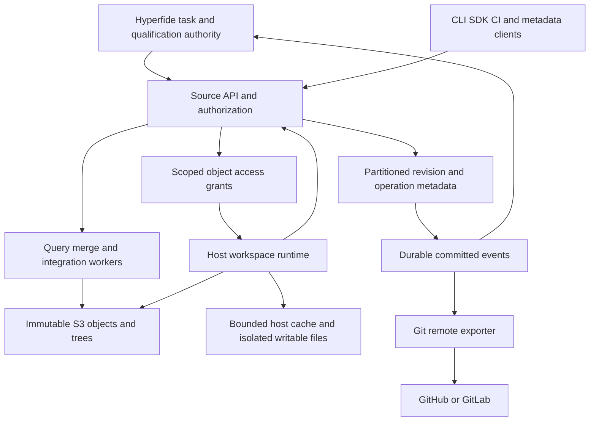

# Native source-control design

Status: design draft. The [native specification](spec.kvx) is normative; all product verification is UNRUN.

## 0. Repository-layout prerequisite

The [category-layout contract](repository-layout.md) and [path mapping](repository-layout.json) precede native implementation. Tasks 0.3–0.9 reorganize the existing product; fleet tasks 0.10–0.14 follow its qualification, then task 0.1 requires the final fleet receipt. New source-control paths below are post-layout destinations. Inspected legacy source links remain baseline references.

The [fleet contract](fleet-orchestration.md) gives the Primary and same-box Wave Managers planning authority through scoped tools. Deterministic enforcement belongs to the engine. The [sandbox manifest contract](sandbox-contracts.md) makes `.neron` source configuration and `package.kvx` environment installation prerequisites of worker execution, with selected [interface contracts](interface-contracts.md). An explicit existing-source adapter supports qualification before native SCM exists.

## 1. Product and responsibility boundaries

Hyperfide source control is a native subsystem of the product, exposed through versioned APIs and separately scalable services. The existing C command line and TypeScript platform remain integration surfaces. The initial service implementation is proposed in `core/control-plane/src/source_control/`; that location is an implementation namespace, not a new global process or database bottleneck.

| Authority | Owns | Does not establish |
|---|---|---|
| Hyperfide task authority | Task intent, attempt identity, assignment, custody, qualification policy, dependency release | Source durability merely because a process exited successfully |
| Source-control authority | Source revisions, root pins, workspace mutations, valid integration transactions | Task completion merely because source was saved or accepted |
| Object storage | Immutable payload persistence under the configured durability profile | Atomic multi-object commits or task ownership |
| Host workspace runtime | File layout, local edit journal, bounded cache, upload transport | Offline authority or ownership after its generation is superseded |
| Remote publication adapter | Export mapping, authorized publication, remote outcome reconciliation | Native integration or release success from a push attempt alone |

Basic source operations also support authorized humans and automated tools without a Hyperfide task. Task-bound operations carry task and attempt identities; taskless operations carry their own principal and operation scope. Neither can bypass source authorization.

## 2. Governing invariants

1. Clients are online. A client may preserve dirty local bytes during a disruption, but cannot claim a remote checkpoint or exercise expired authority. Reconnection is reconciliation, not history federation.
2. Clients do not clone repository history. Servers compute history, blame, diffs, merges, rebases, and revision objects. Hashing changed bytes, cache management, file layout, and change monitoring remain client responsibilities.
3. Every operation has an API contract. The CLI, SDK, filesystem, graph tools, CI, and remote adapters are consumers of those contracts.
4. No service requires a full repository checkout or complete local object replica. Explicit client materialization may cover a whole source snapshot when the workload requires it; that is an observable, budgeted operation without history download.
5. Immutable revision creation never needs a repository-wide lock or shared branch-head update. Acceptance into a globally ordered trunk requires a short scoped ordering transaction; it is not described as coordination-free.
6. Ordinary mutations touch changed content and relevant persistent-tree nodes. Necessary history traversal and dependency validation have their own measured budgets. No promise of constant wall-clock time is made for an arbitrarily large merge or validation graph.
7. Optional names and release channels are resolved to immutable identities. No worker needs to enumerate or update a global branch/tag namespace to save work.
8. A snapshot, scope, toolchain, policy, and validation result are identified explicitly. Rebase, merge resolution, or source changes create new identities; old passing results do not automatically qualify the new tree.
9. Git compatibility is confined to remote import/export. Native objects have no Git packfile/repack dependency. A bounded transient Git pack stream is permitted at the transport boundary.
10. Source reads, caches, history, search, deduplication, exports, and object grants obey the same authorization boundary. A content hash is an identity, not permission to retrieve content.

## 3. Logical repository and physical distribution

One repository contains a shared namespace and revision DAG. A project identifies ownership, dependencies, and export scope; it is not a physical storage partition. A large project and even a hot directory can span multiple partitions. Storage partitions can split independently of project paths and repository identities.

Source objects use versioned, type-tagged canonical encodings. The proposed identity format is `sha256:<64 lowercase hexadecimal digits>`. Git object IDs and existing raw snapshot identifiers have separate typed envelopes and explicit migration mappings. A stable logical change identity is not interchangeable with an immutable revision identity.

Persistent bounded tree nodes map names to child objects. An immutable root identifies the entire logical source state without materializing it. Updating a file reuses unrelated subtrees; inserting into a huge directory must not rewrite all siblings. Schemas and algorithm rules are specified in [storage.md](storage.md).

Metadata partitions handle revision identities, operation records, pins, workspaces, and indexes. The initial PostgreSQL implementation must demonstrate within-repository routing, bounded transactions, and a migration path for partition splits. A single database deployment is a bootstrap topology, not evidence of unlimited horizontal scale.

## 4. Serving architecture

Direct authorized object transfer keeps source bytes off the coordinator's hot path. Authorization grants are bounded in scope and time; issued grant revocation limits are explicit. Caches cannot broaden access. Query and merge workers fetch only required objects and maintain bounded state. Broad queries return pagination or durable operation handles rather than allocating whole histories in one process.

## 5. One task from assignment to publication

1. Hyperfide issues a task assignment pinned to repository, source revision, scope manifest, environment profile, task, attempt, and authority generation.
2. The host opens a native workspace without creating a Git checkout. Its scope includes requested source plus declared build/metadata dependencies. A missing dependency produces an explicit expansion request or a diagnosed failure, never a silent read from a different snapshot.
3. The agent uses API-only access, a virtual filesystem, or materialized files. The host caches immutable objects and isolates writes. Sparse omission is not a deletion; explicit tombstones refer to an observed base entry.
4. Changed content is uploaded and verified. A checkpoint transaction binds ready object receipts, the pinned base, explicit changes, and current workspace authority. Its acknowledgement identifies the durable revision and durability profile. Local save, upload completion, and durable checkpoint are distinct.
5. The agent submits a revision. Hyperfide transfers submission custody so worker expiry does not invalidate an already accepted handoff; superseded workers cannot modify it.
6. The server prepares an integration candidate from explicit parents. Text conflicts, binary conflicts, and semantic validation failures remain distinct. Automated conflict repair produces another revision.
7. Hyperfide qualifies the candidate with exact source, toolchain, dependency inputs, policy, and checker identities. Reusable evidence has explicit applicability rules; incomplete graph coverage broadens validation.
8. A short source acceptance transaction checks candidate, expected predecessor, evidence, custody, policy version, and root pins. It emits a committed event. A competing acceptance triggers bounded reconciliation, not unbounded agent-side rebases.
9. Hyperfide releases dependent tasks according to its required milestone. The remote exporter independently projects accepted source to authorized Git destinations and reconciles ambiguous push results. Remote failure does not erase native acceptance.

## 6. Scale and admission

The [verification profile](verification.md) proposes 5,000 active agent workspaces, 100,000 new native revisions/day, 100 submissions/second for five-minute bursts, and twenty million metadata-only workspace opens/day. These are independent dimensions. Their simultaneous composition is defined by a workload manifest; passing separate peaks does not establish their combined peak.

Admission separates upload bytes, object request count, metadata writes, query cost, merge cost, graph extraction, qualification, materialization, and remote export. Large imports cannot consume all foreground permits. Hot paths and shared interfaces produce local contention that remains visible even if aggregate capacity is available. Priority aging and bounded queues prevent indefinite starvation.

Performance evidence includes repository size, file-size distribution, directory shape, history topology, changed-file count, dependency fan-out, request latency percentiles, cache warmth, CPU, memory, bytes, S3 requests, and acceptance retry rate. Increasing total repository size while holding the changed set fixed is a dedicated test. There is no conversion from lines of code to object-store capacity without measured bytes.

## 7. Failure and recovery

Object uploads precede metadata publication. Abandoned uploads are reclaimed only after upload leases and reference protections permit it. GC, acceptance, export, workspace reads, and backup snapshots share explicit root-pin semantics. Delayed deletes cannot remove newly adopted object generations.

Operations use idempotency keys bound to their request digest and principal. An unknown response is resolved by operation lookup; a retry with changed parameters is rejected. Committed event replay uses a cursor safe against transaction commit reordering and retention gaps. Restore establishes a new authority epoch and reconciles external publication effects before reopening writes.

The consistency and failure-domain contracts live in [protocol.md](protocol.md), [storage.md](storage.md), and [identity-security.md](identity-security.md). No S3 compatibility claim implies another vendor has identical consistency, conditional-write, or restore behavior.

## 8. Adoption and bounded supersession

This feature changes the source backend through explicit adapters. It preserves existing task authority, qualification semantics, product identity, and legacy evidence readability. [migration.md](migration.md) identifies the authority cutover and the exact earlier assumptions it replaces for migrated repositories.

The first implementation delivers a real object-backed revision path consumed by a client; later tasks add materialization, server operations, qualification and acceptance, fleet integration, remote compatibility, consolidation, and fault/scale qualification. Each task pairs its producer with a direct consumer and real positive/negative checks. The final wave closes documentation and release evidence. No implementation status is inferred from this document.
